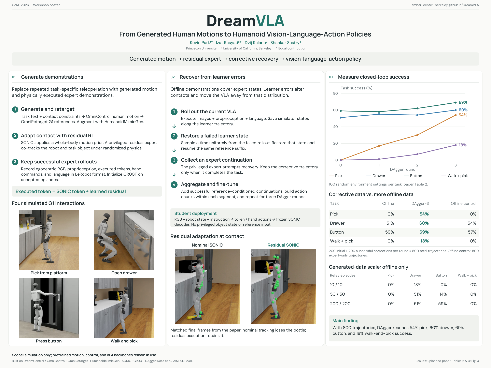

# DreamVLA — website-style CoRL poster

This branch contains the **48 × 36 inch, landscape, website-style poster** for
DreamVLA. Its warm paper background, sage green accents, centered wordmark,
Manrope headings, and DM Sans body text follow the
[DreamVLA project website](https://ember-center-berkeley.github.io/DreamVLA/).

- [Poster PDF](DreamVLA_CoRL_poster.pdf?raw=1)
- [Editable SVG](DreamVLA_CoRL_poster.svg?raw=1)
- [PNG preview](DreamVLA_CoRL_poster_preview.png?raw=1)



## Results and provenance

The content matches the paper-updated poster approved by the authors; this is a
design variant, not a new experiment. Quantitative values come from Tables 2 and
4 of the supplied paper, rather than the older values displayed on the website.
Final three-round DAgger success is **54% pick, 60% drawer, 69% button, and 18%
walk-and-pick**. The paper reports 100 random evaluation settings per task,
200 initial trajectories, and 200 successful corrections per round (800 total).

`poster_data.json` records the results and their source tables/pages. The reviewed
paper has SHA-256
`4d4f62ff639e409b9154c601b137954f24805a4714b4bc7939fac85402ab1c66`.
**The uploaded paper itself is deliberately not bundled.** The files
`paper_extracted.txt`, `paper_page_*.png`, and `build_poster.py` are historical
assets inherited from the original `poster` branch, not revised-paper sources
or the current website-style generator.

`publication_manifest.json`, `layout_checks.json`, and `final_validation.json`
describe the current poster. The prebuilt PDF, SVG, and PNG are the exact approved
files, with embedded fonts and images. No datasets, environments, checkpoints,
credentials, or server configuration are included.

## Rebuild

Use Python 3.10+ with virtual-environment support:

```bash
python3 -m venv .venv
.venv/bin/python -m pip install -r requirements.txt
.venv/bin/python build_website_poster.py
.venv/bin/python verify_website_poster.py --directory build
```

Outputs go to `build/`, leaving the committed poster untouched. The static fonts
are included; no system-font installation or network request is needed to render.
An optional source PDF can be verified during a rebuild:

```bash
.venv/bin/python build_website_poster.py --source-pdf /path/to/paper.pdf
```

Its hash must match the reviewed source. A build without that optional file
explicitly records that the paper hash was not reverified at build time.

To verify the exact committed deliverables:

```bash
.venv/bin/python verify_website_poster.py
```

The rebuild verifier compares semantic text and image payloads, rather than
requiring byte-identical PDF serialization across builds. To recreate the static
font instances from the included variable fonts, run `prepare_website_fonts.py`.
Font licensing notices are retained under `website_theme/fonts/`. The approved
prebuilt documents also embed an unused Liberation Sans fallback; its original
font-embedding exception and license notice are included. New builds use the
included DM Sans as fallback and do not need Liberation Sans.
